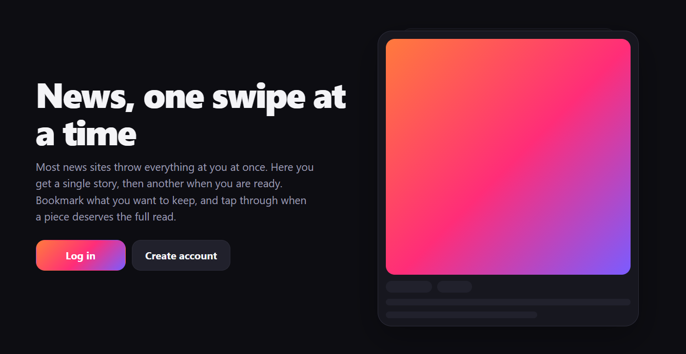
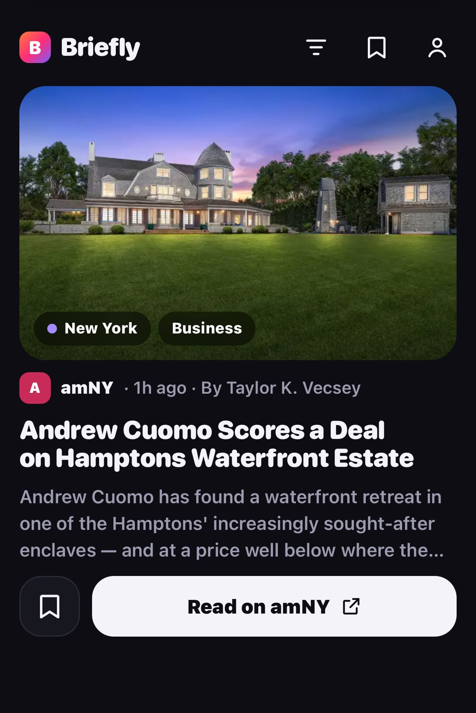
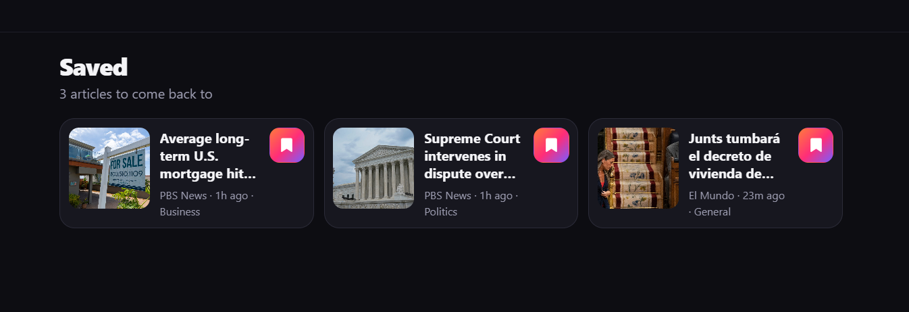

# Briefly

A news reader. One story on screen at a time. Scroll or swipe for the next one.
Opening a card takes you to the original article.

Live: [https://briefly.malcolmjdstudio.com](https://briefly.malcolmjdstudio.com)

## Feed

Logged-in users get a vertical feed of recent articles from a list of RSS/Atom
sources. Each card shows the image (when the feed has one), title, excerpt,
source, time, and category. Stay on a card for about a second and it is marked
seen so it does not keep coming back.

- Bookmark a card to save it
- Filter by keyword or category
- Light, dark, or system theme
- English and Spanish sources

On a computer: `j` / down for the next card, `k` / up for the previous, `s` to
save, `o` or Enter to open the article.

## Saved

Saved articles have their own page. There is also a seen list (text only) of
cards you have already gone past.

## Sources

The first account you create is the admin. From the menu you can manage sources:
approve, reject, disable, inspect what metadata a feed actually provides, and
add new ones by pasting a homepage, article, or feed URL. Briefly looks up the
feed itself. It does not scrape pages or go around paywalls or bot protection.

A seed list of outlets is included (US, Spain, EU, UK/Europe, international).
You can add more later.

Background fetching is meant to run every 15 minutes (`cron/fetch.php`). If cron
is not set up, the feed still tops up when you run low.

## How it is built

Plain PHP 8.1+ and SQLite. No framework, no Composer, no Node, no build step.
Vanilla CSS and JavaScript.

Stories from the last 7 days are clustered when they look like the same event,
then ranked so the same source, place, and topic do not dominate a stretch of
cards.
